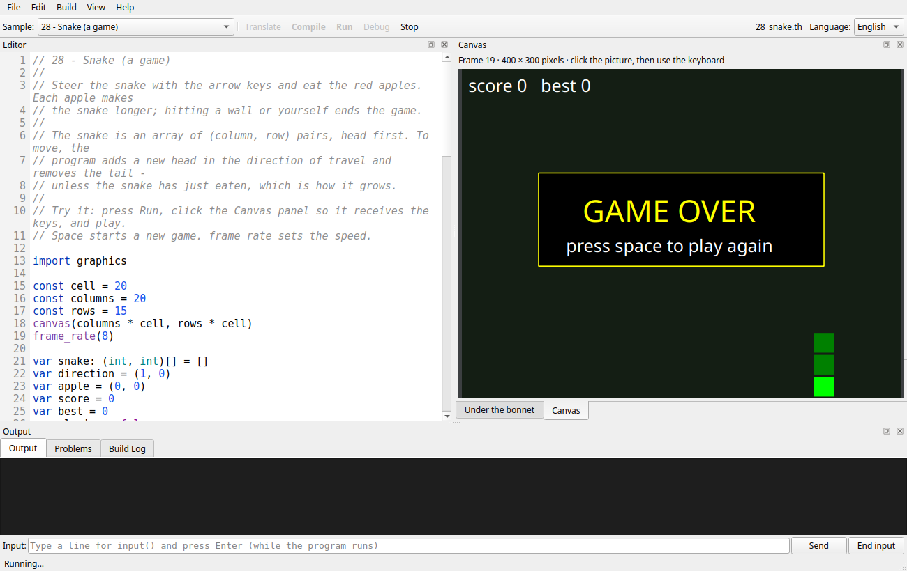
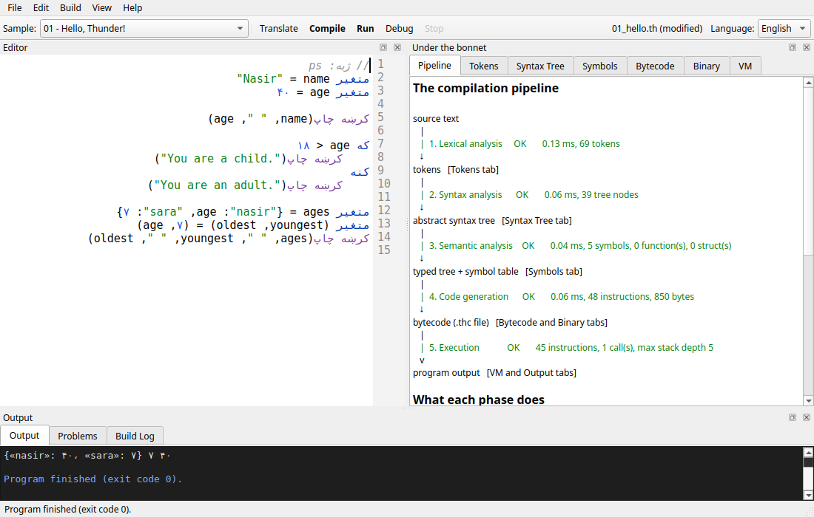

# Thunder: an educational programming-language toolchain

**Thunder** is a small, statically typed programming language with a complete toolchain built
for teaching **Programming Language Technology (PLT)**: a compiler, a virtual machine and an IDE
that shows what happens to a program inside each phase. Programs can be written in **English or
Pashto (پښتو)**, and the IDE is available in both languages, with a right-to-left layout for
Pashto.

```
source --lexer--> tokens --parser--> syntax tree --semantic analysis--> symbols & types
       --code generator--> bytecode (.thc) --virtual machine--> output
```

The IDE shows each of these artefacts in its own tab: the token stream, the abstract syntax tree,
the scopes and symbol table, the bytecode listing, a hex dump of the compiled file, and a
step-by-step debugger that shows the VM's stack and call frames, forwards and backwards.

## Quick start

| | Linux | Windows (PowerShell) |
| --- | --- | --- |
| Start the IDE | `./run.sh` | `.\run.ps1` |
| Install the VS Code extension | `ide/vscode/scripts/install.sh` | `ide\vscode\scripts\install.ps1` |
| Run all tests with coverage | `./run_tests.sh` | `.\run_tests.ps1` |

The first run builds the C++ toolchain into `build/release` (about a minute), sets up a Python
environment for the IDE in `.venv` with PySide6 (Qt for Python; a few minutes, once), then starts
the IDE. Pick a sample from the **Sample** list and press **Compile**, **Run** or **Debug**.

If PowerShell refuses to run scripts, use
`powershell -ExecutionPolicy Bypass -File .\run.ps1` (or `Set-ExecutionPolicy -Scope CurrentUser RemoteSigned`).

### Requirements

| | Linux | Windows |
| --- | --- | --- |
| C++ compiler | GCC 14+ (tested with GCC 15.2) | Visual Studio 2022/2026 with "Desktop development with C++" |
| Build system | CMake 3.25+ (Ninja optional) | CMake 3.25+ |
| Python | 3.10+ (`python3`; on Debian/Ubuntu also `python3-venv` if available, otherwise pip is bootstrapped automatically) | 3.10+ from python.org |
| Optional | `clang-tidy` (`./run_tests.sh --tidy`) | [OpenCppCoverage](https://github.com/OpenCppCoverage/OpenCppCoverage) for C++ coverage |

The C++ code uses only the standard library (C++23 mode) and the test tools only the Python standard
library; the IDE's single dependency is **PySide6** (Qt for Python), which gives correct
bidirectional editing and Pashto letter shaping on every platform. `run.sh`, `run.ps1`,
`run_tests.sh` and `run_tests.ps1` install it automatically into `.venv` (see `tools/pyenv.py`; set
`THUNDER_PYTHON` to use another interpreter, or `THUNDER_NO_VENV=1` to forbid the automatic set-up). Settings (language, font size,
panel layout) are saved in `~/.config/thunder/ide.json` (Windows: `%APPDATA%\Thunder\ide.json`).

## A taste of Thunder

```thunder
# Thunder marks blocks by indentation, needs no semicolons and writes and / or / not as words.
struct Scientist
    name: string
    born: int

func fibonacci(n: int): int
    if n < 2
        return n
    return fibonacci(n - 1) + fibonacci(n - 2)

var people = [Scientist("Ada", 1815), Scientist(born: 1912, name: "Alan")]
var sum_of_years = 0
for person in people                       # "for ... in" walks arrays, strings and maps
    sum_of_years += person.born            # "+=" is "sum_of_years = sum_of_years + ..."
    if person.born > 1800
        println(person, " -> ", fibonacci(len(person.name) + 10))
println("average year: ", to_float(sum_of_years) / len(people))   # decimals: 1863.5
dump(people[0])      # Scientist, then one field per line: name: string = "Ada" ...
```

The same program in Pashto. `thunderc --translate ps` (or the IDE's Translate button) converts the
keywords, built-ins, digits and commas; the names are the programmer's own:

```thunder
# ژبه: ps
جوړښت پوه
    نوم: متن
    زیږون: عدد
...
تکرار سړی په خلک                            # «تکرار ... په» د لړۍ توکي ګرځوي
    د_کلونو_ټولټال += سړی.زیږون
    که سړی.زیږون > ۱۸۰۰
        کرښه چاپ(سړی، " ← "، فیبوناچي(اوږدوالی(سړی.نوم) + ۱۰))
کرښه چاپ("منځنی کال: "، اعشاري کړه(د_کلونو_ټولټال) / اوږدوالی(خلک))
```

The language has `int`, **`float`** (decimals), `bool`, `string`, **`byte`** (and `byte[]` for raw
data: files, sounds, packets), arrays (`T[]`), **tuples** (`(int, string)`), **maps**
(`{string: int}`), **structs** and **enums** (`Direction.north`), variables and constants with type
inference, `if`/`else`, `while`, counting `for` loops and **`for value in collection`**,
compound assignment (`+=` `-=` `*=` `/=` `%=`), `break`/`continue`, functions with recursion,
**functions as values** (`func(int): bool`) and **closures** (`func() count += 1` captures the
variables around it), **objects** - structs with **methods and a constructor** in their body (no
`self` to write: a bare member name inside a method means the receiver's member; members whose
names start with `_` are private, as a module's are), **interfaces** with dynamic dispatch
(`interface Widget`; `struct Button: Widget, Clickable`) and single-level **mixins** -
**modules** (`module geometry`, used as
`geometry.area(r)`) and **`with`**, which closes a resource - a file, a socket - through its
`close()` method when its block ends, however it ends. Blocks are marked by indentation, as in Python, and
statements end at the end of the line. The only implicit conversion is `int` → `float`, so
`1 + 0.5` and `n / 2.0` work while a decimal is never silently truncated. Every error has a stable code and is reported by the phase that detects it:
lexical, syntax, semantic or runtime. There is no undefined behaviour: overflow, division by zero
and out-of-bounds indexing are reported as runtime errors.

Programs can be split into several files (`import "lib/geometry"`), each declaring **modules** -
named bundles of functions, structs and variables, with private `_` members - and can **read
input** (`input("Name? ")`). The **library** of built-in functions is organised the same way. The
default module needs no prefix: pairs (`first`, `second`, `zip`, `enumerate`), lists (`push`,
`pop`, `sort`, `slice`, `map`, `filter`, `reduce`, ...) and conversions (`to_int`, `to_float`,
`str`). The others are written with their module in front: text in **`string`**
(`string.substring`, `string.trim`, `string.to_upper`, `string.split`, `string.join`,
`string.format`, ...), maths in **`math`** (`math.abs`, `math.min`, `math.round`, `math.sqrt`,
`math.pow`, `math.sin`, `math.pi`, ...), **`random`** (`random.int(1, 6)`), **`bytes`** and
**`task`**, the concurrency kernel. The
modules that reach outside the program are imported by name: **`os`** (`import os`) gives access
to shell commands, directories, the clock, the environment and the program's command-line
arguments, **`file`** (`import file`) reads and writes files, and **`graphics`** (`import
graphics`) draws pictures, animations and games on a canvas, with keyboard and mouse input: the
samples go from a still drawing to bouncing balls, fireworks, the Game of Life and Snake.

A program can also do several things at once. A **task** is a green thread the virtual machine
runs itself, so nothing races in C++ and **the schedule is the same on every run** - a lost
update can be shown, stepped through in the debugger and golden-tested, and a **deadlock is a
runtime error with a message** (`R037`) rather than a program that hangs. The kernel is the
module `task` (spawn, join, sleep, yield, locks and conditions); `import "concurrency"` adds
the objects built on it, in Thunder itself: `Task`, `Mutex` (used through `with m.lock()`),
`Condition`, `Semaphore`, `Barrier`, `Channel<T>`, `WaitGroup`, `Latch`, `ReadWriteLock` and
`timer.after` / `timer.every`. See the [concurrency reference](docs/concurrency.md).

```thunder
import "concurrency"

var jobs: Channel<string> = Channel(4)

func work()
    while jobs.has_next()
        println(task.name(task.current()), " did ", jobs.receive())

var one = Task(work)
var two = Task(work)
for n in range(1, 6)
    jobs.send("job " + str(n))
jobs.close()
one.join()
two.join()
```

```thunder
import "lib/geometry"          # lib/geometry.th declares the module geometry

func is_big(r: geometry.Rectangle): bool
    return geometry.area(r) > 10

var rooms = [geometry.Rectangle(4, 3), geometry.Rectangle(2, 2)]
println(len(filter(rooms, is_big)), " big room(s)")
var name = string.trim(input("Your name? "))
println("Hello, ", string.to_upper(name))
```

Three doors lead out of the language itself. **`import native "mathx"`** calls functions
written in **C++** (and lets that C++ call Thunder back) through a small C interface — one
header, one entry point: the [native interface reference](docs/native.md), with a working
example in `lib/native/`. **`thunderc --package myapp`** (or **Build > Package as an
application** in the IDE) writes a single native executable that runs the program on its own,
without the IDE or the virtual machine: the [packaging reference](docs/packaging.md). And
**`thundervm --display sdl`** gives a graphics program a **window of its own** through a
display plug-in — an **SDL2** one, a **Win32** one (GDI, Windows only) and a minimal one are in `lib/display/`, and another can
be written for any graphics library: the [display reference](docs/display.md).

See the **[language reference](docs/language.md)** (objects, modules and `with` included), the
**[library reference](docs/library.md)** (the built-in functions, module by module: input, text,
maths, `os`, `file`, ...), the
**[graphics reference](docs/graphics.md)**, the **[bytecode and VM reference](docs/bytecode.md)**,
the **[native interface reference](docs/native.md)**, the
**[packaging reference](docs/packaging.md)**, the **[display reference](docs/display.md)**, the
**[sockets reference](docs/sockets.md)** (talking over the network), the
**[concurrency reference](docs/concurrency.md)** (tasks, locks, conditions, channels and timers)
and the **[debugging reference](docs/debugging.md)** (the live debugger and its protocol)
(all ten are also under the IDE's Help menu, in Pashto too). The whole reference is also an
**[HTML API documentation site](docs/api/index.html)** (`docs/api/`, generated by
`tools/apidoc.py`) - keywords, every built-in, the SDK modules' functions and structs, the
instruction set and the guides, searchable, in English and Pashto with a language switch on every
page. The reference starts at **[docs/README.md](docs/README.md)**; Pashto translations live in **`docs/ps/`**, and the
IDE's Help menu opens the HTML documentation in a browser window inside the IDE - the API pages and
the guides, in the interface's language, with the site's own search.



## Using the IDE

* **Language (English / پښتو):** switches the whole interface, the sample list and the default
  program language. Pashto uses a mirrored, right-to-left layout.
* **Sample list:** 40 English programs in teaching order - the language first (hello world →
  arithmetic → variables → decimals → strings → conditionals → `while` and the two `for` loops →
  functions and recursion → scope → arrays, sorting and matrices → bits and bytes → structs →
  enums → tuples → maps → text → lists and functions as values → modules, private members and
  the built-in modules), then the SDK (input → the `os` and `file` modules → testing, with a
  module per test suite → drawing → animation, trigonometry, orbits and a pendulum → a particle
  simulation → the Game of Life → Snake → calling C++ → sockets → `with`, resources that close
  themselves → concurrency: tasks, the lost update and the lock, channels, sleeping) - and 5
  with deliberate errors and an infinite loop. The **advanced** samples
  (`samples/advanced/<language>/`, deliberately not in the picker) go further: the data
  structures, the algorithms, and one each for tasks, mutexes, channels, barriers and wait
  groups, the dining philosophers and timers. Every sample also exists in
  Pashto, under the same file name and with Pashto names throughout, so switching the language
  loads the same lesson. The library files the samples import are in `samples/<language>/lib/`.
* **Canvas:** programs that `import graphics` draw in the Canvas panel (a tab next to "Under the
  bonnet", brought to the front by the first frame). Click it to give it the keyboard for games;
  the mouse works too. The picture scales with the panel.
* **Program input:** while a program runs, the **Input** line under the Output panel sends what
  you type to `input()` (press Enter or Send; **End input** ends the input). Prompts appear as
  soon as the program writes them. Programs run in the directory they were opened from, and files
  they import are looked for there.
* **Dockable panels:** the Editor, "Under the bonnet" (all the compiler tabs) and Output are Qt dock
  widgets. Drag a panel's title bar to move it to another side, drop it onto another panel to tab
  them, double-click the title (or use ⧉) to float it in its own window, or close it (✕; View >
  Panels brings it back). Drag the borders between panels to resize them. View > Reset panel
  layout restores the default.
* **Live syntax highlighting** while typing, for English and Pashto programs.
* **Format menu - fonts:** a program is drawn in a *pair* of fonts, a code font for Latin letters,
  digits and symbols and a **Pashto font** for Arabic-script text, chosen under Format > Code font
  and Format > Pashto font (each entry is shown in its own font), with Larger/Smaller font and
  Default fonts and size. The IDE ships five open-source (SIL OFL) Pashto fonts - **Vazirmatn**
  (the default), Noto Naskh Arabic, Noto Sans Arabic, Scheherazade New and Lateef - and the code
  font **JetBrains Mono**, in `ide/thunder_ide/fonts/`. Only monospaced fonts *without* Arabic
  glyphs are offered for code: a code font that has its own Arabic (DejaVu Sans Mono, Courier
  New) would draw the Pashto itself, which is what made Pashto hard to read before.
* **Compile (F7):** fills every tab. Click a token, tree node, symbol, instruction or problem to
  highlight its source.
* **Run (F5) / Stop (Shift+F5):** runs the program and streams its output. A step limit and the
  Stop button keep infinite loops from freezing the IDE.
* **Debug (F9):** records the execution and opens the **VM** tab. Step by instruction or by
  source line, forwards and backwards, and watch the operand stack, frames, locals and globals.
* **Pipeline tab:** each phase's status, timing and output size, and what the phase does.
* **Indentation as you type:** Enter keeps the indentation, indents after a line that opens a block
  and un-indents after `return`, `break`, `continue` or `pass`; Tab inserts four spaces and Backspace
  in the leading whitespace removes a level. **Tidy layout** (Edit menu) turns tabs into spaces,
  drops trailing spaces and extra blank lines — but never changes the *amount* of indentation:
  with indentation syntax the layout *is* the program, so re-indenting would be rewriting it.
* **API help on hover (Settings menu):** resting the pointer on a name shows its documentation
  as a tooltip - a built-in shows its API reference (signature and description, in the program's
  language: a Pashto program's tooltip writes `اعشاري`, not `float`), and a function, struct,
  method or constant the program or an imported file declares shows its signature and the `#`
  comment block written above it, the declaration's "JavaDoc" (the SDK's files are documented
  that way, so `s.push(1)` on a stack explains push and names `datastructures.th`). The bottom
  line names it in the other language - `پښتو: کرښه چاپ` under `println`, `English: math.pow`
  under `ریاضي.توان` - for built-ins and for the SDK's declarations, which exist in both
  languages. Works in right-to-left programs too, and needs no compile: it reads the editor's
  text as it is.
* **IntelliSense (Settings menu):** completion while typing, as in VS Code. After a letter the
  list offers what fits there - the names in scope (locals, parameters, a struct's own members
  inside its methods), the program's and its imports' declarations, the built-ins and the
  keywords, all in the program's language; after a dot it offers a module's functions
  (`math.`), an enum's members (`Direction.`), a module block's members (`geometry.`) or the
  fields and methods of the struct a variable holds (`s.` on a `Stack`); after `:` the types;
  after `import` the modules and the program's module files. `Ctrl+Space` asks at any time;
  `Up`/`Down` choose, `Enter` or `Tab` takes the item (a function comes with its brackets and the
  caret inside them), `Escape` closes the list. Inside a call's brackets a hint above the caret
  shows the signature with the current parameter underlined. Pashto multi-word built-ins
  complete over both words (`کرښه چ` -> `کرښه چاپ`).
* **Both are off by default.** A learner who types a function out and looks it up in Help >
  Full API reference learns it; a teacher can turn either on under **Settings**, and the choice
  is remembered.
* **Translate (Ctrl+T):** converts the program between English and Pashto keywords, built-ins,
  digits and the names of the SDK modules it imports (`Stack` ↔ `ډېرۍ`, `Task` ↔ `کار`), and
  writes each language's comma (`,` in English, `،` in Pashto) and the plain quote.
* **Right-to-left editing:** the editor itself switches to right-to-left layout whenever the program
  is in Pashto, token by token (see "Right-to-left programs" below); no separate view is needed.
* **Find and replace (Ctrl+F, Ctrl+H), comment/uncomment (Ctrl+/), tidy layout
  (Ctrl+Shift+F), folding (Ctrl+Shift+[ and ]) and "show spaces and tabs"** — the usual
  editing commands, in the Edit and View menus. The text work itself is in
  `ide/thunder_ide/core/edits.py`, independent of any toolkit.
* **Package as an application (Build menu):** writes the program in the editor as a single
  native executable, together with any C++ libraries it uses
  ([packaging reference](docs/packaging.md)).
* **Build Log:** the exact `thunderc` / `thundervm` commands the IDE ran, so you can repeat them
  in a terminal.

## Thunder in VS Code

The Qt IDE is the teaching tool: one window that shows every phase of the compiler. For larger
work - several folders, many files, source control - there is a **VS Code extension** in
[`ide/vscode/`](ide/vscode/README.md) that puts the same toolchain into an editor people already
use:

* **Syntax highlighting** for English and Pashto, from a grammar generated out of the language
  packs, refined by **semantic highlighting** that comes from the compiler's own token stream.
* **IntelliSense:** completion (keywords, built-ins of the modules the file imports, the names in
  scope, struct fields after a `.`), signature help, hovers that show the inferred type and the
  word's counterpart in the other language, go to definition across modules, references, rename,
  outline and inlay hints.
* **Diagnostics** from `thunderc` as you type, with the phase and the error code, in the file
  each problem is in - imported modules included.
* **Projects:** a `thunder.json` naming the entry point, the language and the module paths;
  **Thunder: New Project...** writes one with a program, a module and the VS Code task and launch
  files, in either language.
* **Build, run and package** as VS Code tasks (programs run in a terminal, so `input()` works),
  and **a live debugger that also steps backwards**: `thundervm --debug` runs the program under
  the extension's control - breakpoints with conditions, step in/over/out, pause, the call stack
  with every frame's variables, watches, `input()` from the Debug Console - and remembers the
  lines it ran, so Step Back and Reverse Continue walk the history. The right-to-left editor
  shows the stopped line and the breakpoints too. The protocol is in
  [docs/debugging.md](docs/debugging.md).
* **Under the bonnet:** the tokens, syntax tree, symbols, bytecode listing and hex dump of the
  current program, each as a document beside it.
* **Right-to-left programs:** VS Code's text editor always lays code out left to right (an
  extension cannot change that), so a Pashto program opens in the extension's own
  **right-to-left editor**: laid out token by token by the same algorithm the Qt IDE uses, with
  editing, indentation, undo, completion and the compiler's problems, on the same document.

It is plain JavaScript with no dependencies: neither Node.js nor npm is needed to install,
develop or test it. `ide/vscode/scripts/install.sh` (or `install.ps1` on Windows) packages it
and lets VS Code install it; `samples/project/` is a multi-file project to try it on, and the
[extension's README](ide/vscode/README.md) has the whole set-up, the settings and how to run its
tests.

## Command-line tools

```
thunderc program.th                    # compile to program.thc
thunderc --emit all program.th         # print tokens, AST, symbols, bytecode and hex dump
thundervm program.thc                  # run (input() reads standard input)
thundervm --trace --stats program.thc  # watch every instruction execute
thunderc -I mylibs program.th          # also look for imported modules in mylibs/
thundervm program.thc one two          # pass arguments to the program (os.args())
thunderc program.th --package myapp    # write a native executable that runs on its own
thundervm --native-path libs prog.thc  # where "import native" looks for C++ libraries
thundervm --display sdl game.thc       # show a graphics program in a window of its own
thundervm --svg picture.svg drawing.thc   # save the picture a graphics program drew
```

`thundervm` exits with 0, or with the code given to `os.exit(code)`; 1 means a runtime
error and 2 a usage error or an invalid bytecode file.

After `./run.sh` (or `./run_tests.sh`) the executables are in `build/release/bin` (or
`build/coverage/bin`). To build them by hand:

```
cmake -S . -B build/release -DCMAKE_BUILD_TYPE=Release
cmake --build build/release --config Release
```

## Tests and quality checks

`./run_tests.sh` / `.\run_tests.ps1` builds an instrumented copy of the toolchain in
`build/coverage` and runs:

* **C++ unit tests** for the lexer, parser, semantic analysis, code generator, bytecode format,
  VM and reports. They use a small built-in test framework (`tests/cpp/minitest.hpp`).
* **Golden tests:** every sample's complete output and diagnostics, in both languages, must match
  `tests/golden/<language>/*.expected`. After an intentional change, regenerate them with
  `THUNDER_UPDATE_GOLDEN=1 build/coverage/bin/thunder_tests samples` and review the diff.
* **Python tests:** the IDE logic (through a fake user interface, no toolkit needed), the Qt
  interface (driving the real widgets on Qt's offscreen platform, so nothing flashes up; set
  `THUNDER_TEST_ON_SCREEN=1` to watch), the token-level direction layout, the command-line tools
  and the toolchain interface.
* **VS Code extension tests:** its own JavaScript suite (the compiler's report as a model, the
  language providers against a stand-in for the VS Code API, the debug adapter driven through the
  real protocol, and a live `thundervm --debug` session), run with whatever Node.js is on the
  machine - VS Code ships one, so no separate installation is needed - plus Python tests that the
  generated grammar and snippets still match the compiler, that the extension's "tidy layout"
  agrees with the IDE's character for character, that the project templates compile and run, and
  that the installers work (`tests/python/test_vscode_extension.py`).

It then prints a summary: test counts, line/function/branch coverage for C++ (gcov) and line
coverage for Python (a standard-library tracer, `tools/pycoverage.py`), compiler warnings,
complexity metrics and lines of code. The run **fails** if any test fails or if coverage is below
**90%**. On Linux every test also runs under AddressSanitizer and UndefinedBehaviorSanitizer.
`--tidy` adds clang-tidy static analysis, and `--clean` forces a full rebuild.

## Repository layout

| Path | Contents |
| --- | --- |
| `include/thunder/` | Public C++ headers of the compiler and VM library (`include/thunder/cli/` for the tools; `native.h` is the C interface native modules include) |
| `src/core/` | The compiler and VM library (C++23): lexer, Pratt parser, semantic analysis, code generator, bytecode format, VM, language packs, translator, JSON reports |
| `src/cli/` | `thunderc` and `thundervm` command-line tools |
| `ide/thunder_ide/core/` | The IDE's application logic, independent of any GUI toolkit |
| `ide/thunder_ide/qt/` | The Qt (PySide6) user interface |
| `ide/vscode/` | The VS Code extension (plain JavaScript, no dependencies): language features, tasks, the debug adapter and its own test suite |
| `samples/en/`, `samples/ps/` | Sample programs in English and Pashto (the IDE's Sample list) |
| `samples/project/` | A multi-file sample *project* (entry point, modules, `thunder.json`), for the VS Code extension; not in the IDE's sample list |
| `lib/native/` | Native modules built with the toolchain: the demo (a complete C++ example) and the sockets library |
| `lib/display/` | Display plug-ins (SDL2, Win32/GDI and a minimal text one): a window for a graphics program outside the IDE |
| `tests/cpp/`, `tests/python/`, `tests/golden/` | Test suites and expected outputs |
| `tools/` | Test driver, coverage and metrics tools, IDE launcher |
| `docs/` | Language, library, graphics, bytecode, native-interface, packaging and display references (`docs/ps/`: their Pashto translations) |
| `archive/` | Earlier projects, kept for reference (not part of the build) |
| `devlog.md` | The development log: the original analysis of the legacy code, the design decisions, and a summary of every iteration since |
| `tools/mutation.py`, `tools/crap.py` | Test-quality tools: a mutation tester for the IDE's core modules, and CRAP scores (complexity x coverage) from the coverage run |

## IDE architecture: switching GUI toolkits

The IDE is split so that the GUI toolkit can be replaced without touching the application logic:

* `core/controller.py` holds all the behaviour: files, samples, compiling, running, debugging,
  translating, language switching and settings.
* `core/ui.py` defines the interfaces a toolkit implements: `Backend` and `Scheduler`, and the
  `MainWindowView`, `EditorView`, `TreePanelView`, `TextPanelView` and `VmPanelView` views.
* `core/viewmodels.py`, `core/layout.py`, `core/commands.py`, `core/direction.py` and
  `core/editing.py` provide toolkit-neutral data: table rows, the dock layout, the menu and toolbar
  commands, the token-level text direction of a source line and indentation-aware editing.
* `qt/` is the Qt (PySide6) implementation, about 1,100 lines: `editor.py` (the code editor),
  `panels.py` (tables, text panes, debugger), `main_window.py` (menus, toolbar, dock widgets) and
  `backend.py` (event loop and scheduler).

Another backend would implement the same interfaces and register in `app.py` (`--ui`). The
controller tests use a fake backend (`tests/python/fake_ui.py`), which is also a complete, minimal
example of everything a backend must provide. (The first version of the IDE used Tkinter; it was
replaced because Tk cannot edit bidirectional text or join Pashto letters on Linux. It is in the
git history before this version.)

### Right-to-left programs

Qt lays out, shapes and mirrors bidirectional text itself, so output, tables, menus and messages
need no help. Source code is different: the Unicode Bidirectional Algorithm is made for prose and
merges a run of Latin names, operators and string literals into one left-to-right phrase, so the
Pashto statement `متغیر name = "Nasir"` would come out as `"name = "Nasir متغیر`, with the assignment
reading backwards and a quote mark stranded at the far end.

Thunder programs are therefore read **token by token in the direction of the program's language**:
each name, number, string literal or comment keeps the direction of its own script, and
everything between tokens (operators, brackets, commas) follows the language. A Pashto program with
English names is laid out exactly like a fully Pashto program would be: the keyword at the right,
then the name, then `=`, then the value; `کرښه چاپ(name، " "، age)` shows the function name at the
right with its arguments following to the left, and brackets and `<` `>` are mirrored. The editor
achieves this by wrapping every token of the *displayed* line in Unicode isolate marks
(`core/direction.py`); the program text itself is never changed. In an English program a Pashto
name is treated the same way in the other direction.



## Extending Thunder

The code is organised so that common extensions touch few places:

* **Another natural language:** copy `src/core/language_pashto.cpp`. It contains every keyword,
  built-in name, punctuation mark, digit, quote, output word and compiler/runtime message. Register
  the pack in `language_pack.cpp`, add the IDE's interface text to `ide/thunder_ide/core/i18n.py`,
  and add samples in `samples/<code>/`.
* **A new operator:** add a token in `include/thunder/token.hpp`, its binding power in
  `src/core/parser.cpp`, its type rule in `src/core/sema.cpp` and an opcode in the
  `THUNDER_OPCODES` table in `include/thunder/bytecode.hpp`.
* **A new built-in function:** add it to `src/core/builtins.cpp`, in its built-in module (and a
  translated name to each language pack; a name may consist of several words, like `کرښه چاپ`),
  then type-check it in `sema.cpp` and implement it in `vm.cpp`.
* **A new kind of value:** follow tuples and maps: a `Type::Base`, an expression node in `ast.hpp`,
  a rule in `parser.cpp`, type checking in `sema.cpp`, opcodes in `bytecode.hpp`, code generation
  in `codegen.cpp` and a `Value` kind with its display form in `value.cpp` / `vm.cpp`.

## Licence

MIT. See [LICENSE](LICENSE).
