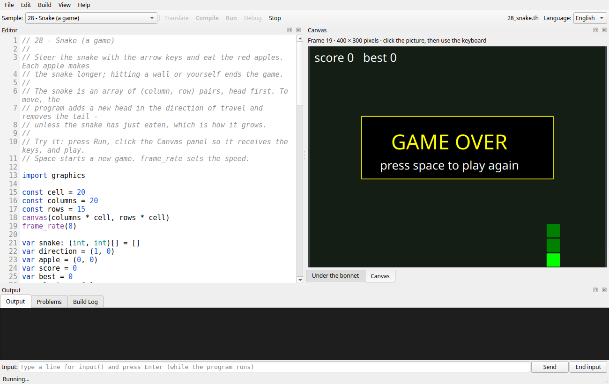
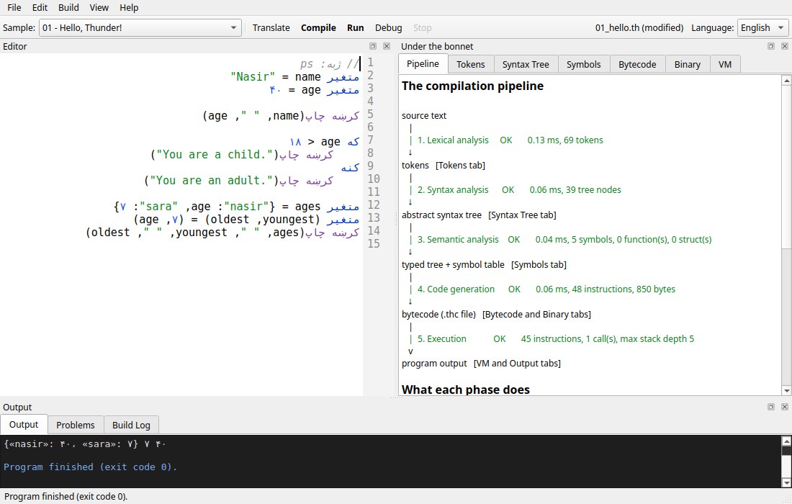

# Thunder: an educational programming-language toolchain

**Thunder** is a small, statically typed programming language with a complete toolchain built
for teaching **Programming Language Technology (PLT)**: a compiler, a virtual machine and an IDE
that shows what happens to a program inside each phase. Programs can be written in **English or
Pashto (پښتو)**, and the IDE is available in both languages, with a right-to-left layout for
Pashto.

```
source --lexer--> tokens --parser--> syntax tree --semantic analysis--> symbols & types
       --code generator--> bytecode (.thc) --virtual machine--> output
```

The IDE shows each of these artefacts in its own tab: the token stream, the abstract syntax tree,
the scopes and symbol table, the bytecode listing, a hex dump of the compiled file, and a
step-by-step debugger that shows the VM's stack and call frames, forwards and backwards.

## Quick start

| | Linux | Windows (PowerShell) |
| --- | --- | --- |
| Start the IDE | `./run.sh` | `.\run.ps1` |
| Run all tests with coverage | `./run_tests.sh` | `.\run_tests.ps1` |

The first run builds the C++ toolchain into `build/release` (about a minute), sets up a Python
environment for the IDE in `.venv` with PySide6 (Qt for Python; a few minutes, once), then starts
the IDE. Pick a sample from the **Sample** list and press **Compile**, **Run** or **Debug**.

If PowerShell refuses to run scripts, use
`powershell -ExecutionPolicy Bypass -File .\run.ps1` (or `Set-ExecutionPolicy -Scope CurrentUser RemoteSigned`).

### Requirements

| | Linux | Windows |
| --- | --- | --- |
| C++ compiler | GCC 14+ (tested with GCC 15.2) | Visual Studio 2022/2026 with "Desktop development with C++" |
| Build system | CMake 3.25+ (Ninja optional) | CMake 3.25+ |
| Python | 3.10+ (`python3`; on Debian/Ubuntu also `python3-venv` if available, otherwise pip is bootstrapped automatically) | 3.10+ from python.org |
| Optional | `clang-tidy` (`./run_tests.sh --tidy`) | [OpenCppCoverage](https://github.com/OpenCppCoverage/OpenCppCoverage) for C++ coverage |

The C++ code uses only the standard library (C++23 mode) and the test tools only the Python standard
library; the IDE's single dependency is **PySide6** (Qt for Python), which gives correct
bidirectional editing and Pashto letter shaping on every platform. `run.sh`, `run.ps1`,
`run_tests.sh` and `run_tests.ps1` install it automatically into `.venv` (see `tools/pyenv.py`; set
`THUNDER_PYTHON` to use another interpreter, or `THUNDER_NO_VENV=1` to forbid the automatic set-up). Settings (language, font size,
panel layout) are saved in `~/.config/thunder/ide.json` (Windows: `%APPDATA%\Thunder\ide.json`).

## A taste of Thunder

```thunder
// Thunder marks blocks by indentation, needs no semicolons and writes and / or / not as words.
struct Scientist
    name: string
    born: int

func fibonacci(n: int): int
    if n < 2
        return n
    return fibonacci(n - 1) + fibonacci(n - 2)

var people = [Scientist("Ada", 1815), Scientist(born: 1912, name: "Alan")]
var sum_of_years = 0
for person in people                       // "for ... in" walks arrays, strings and maps
    sum_of_years += person.born            // "+=" is "sum_of_years = sum_of_years + ..."
    if person.born > 1800
        println(person, " -> ", fibonacci(len(person.name) + 10))
println("average year: ", to_float(sum_of_years) / len(people))   // decimals: 1863.5
dump(people[0])      // Scientist, then one field per line: name: string = "Ada" ...
```

The same program in Pashto. `thunderc --translate ps` (or the IDE's Translate button) converts the
keywords, built-ins, digits and commas; the names are the programmer's own:

```thunder
// ژبه: ps
جوړښت پوه
    نوم: متن
    زیږون: عدد
...
لپاره سړی په خلک                            // «لپاره ... په» د لړۍ توکي ګرځوي
    د_کلونو_ټولټال += سړی.زیږون
    که سړی.زیږون > ۱۸۰۰
        کرښه چاپ(سړی، " ← "، فیبوناچي(اوږدوالی(سړی.نوم) + ۱۰))
کرښه چاپ("منځنی کال: "، اعشاري کړه(د_کلونو_ټولټال) / اوږدوالی(خلک))
```

The language has `int`, **`float`** (decimals), `bool`, `string`, arrays (`T[]`), **tuples**
(`(int, string)`), **maps** (`{string: int}`) and **structs**, variables and constants with type
inference, `if`/`else`, `while`, counting `for` loops and **`for value in collection`**,
compound assignment (`+=` `-=` `*=` `/=` `%=`), `break`/`continue`, functions with recursion, and
**functions as values** (`func(int): bool`). Blocks are marked by indentation, as in Python, and
statements end at the end of the line. The only implicit conversion is `int` → `float`, so
`1 + 0.5` and `n / 2.0` work while a decimal is never silently truncated. Every error has a stable code and is reported by the phase that detects it:
lexical, syntax, semantic or runtime. There is no undefined behaviour: overflow, division by zero
and out-of-bounds indexing are reported as runtime errors.

Programs can be split into **modules** (`import "lib/geometry"`) and can **read input**
(`input("Name? ")`). A **library** of built-in functions works with text (`substring`, `trim`,
`to_upper`, `split`, `join`, `replace`, ...), pairs (`first`, `second`, `zip`, `enumerate`) and
lists (`push`, `pop`, `sort`, `slice`, `map`, `filter`, `reduce`, ...), as well as numbers and
maths (`to_float`, `abs`, `min`, `max`, `round`, `floor`, `ceil`, `sqrt`, `pow`, `log`, `sin`,
`pi`, `random`). The built-in **`os`
module** (`import os`) gives access to files, shell commands, the clock, the environment and the
program's command-line arguments. The **`graphics` module** (`import graphics`) draws
pictures, animations and games on a canvas, with keyboard and mouse input: the samples go from a
still drawing to bouncing balls, fireworks, the Game of Life and Snake.

```thunder
import "lib/geometry"          // Rectangle and area come from lib/geometry.th

func is_big(r: Rectangle): bool
    return area(r) > 10

var rooms = [Rectangle(4, 3), Rectangle(2, 2)]
println(len(filter(rooms, is_big)), " big room(s)")
var name = trim(input("Your name? "))
println("Hello, ", to_upper(name))
```

Three doors lead out of the language itself. **`import native "mathx"`** calls functions
written in **C++** (and lets that C++ call Thunder back) through a small C interface — one
header, one entry point: the [native interface reference](docs/native.md), with a working
example in `samples/native/`. **`thunderc --package myapp`** (or **Build > Package as an
application** in the IDE) writes a single native executable that runs the program on its own,
without the IDE or the virtual machine: the [packaging reference](docs/packaging.md). And
**`thundervm --display sdl`** gives a graphics program a **window of its own** through a
display plug-in — an **SDL2** one and a minimal one are in `samples/display/`, and another can
be written for any graphics library: the [display reference](docs/display.md).

See the **[language reference](docs/language.md)**, the **[library reference](docs/library.md)**
(modules, input, the built-in functions and the `os` module), the
**[graphics reference](docs/graphics.md)**, the **[bytecode and VM reference](docs/bytecode.md)**,
the **[native interface reference](docs/native.md)**, the
**[packaging reference](docs/packaging.md)**, the **[display reference](docs/display.md)** and the
**[sockets reference](docs/sockets.md)** (talking over the network)
(all eight are also under the IDE's Help menu). Pashto translations live in **`docs/ps/`**; the
Pashto interface's Help menu opens them automatically.



## Using the IDE

* **Language (English / پښتو):** switches the whole interface, the sample list and the default
  program language. Pashto uses a mirrored, right-to-left layout.
* **Sample list:** 34 English programs in teaching order (hello world → recursion → arrays →
  sorting → structs → tuples → maps → modules → text → lists and functions as values → input →
  the `os` module → drawing → animation → a particle simulation → the Game of Life → Snake →
  decimals → `for ... in` and `+=` → trigonometry, orbits and a pendulum → calling C++), 5 with
  deliberate errors and an infinite loop. Every sample also exists in Pashto, under the same file
  name and with Pashto names throughout, so switching the language loads the same lesson. Modules
  used by the samples are in `samples/<language>/lib/`.
* **Canvas:** programs that `import graphics` draw in the Canvas panel (a tab next to "Under the
  bonnet", brought to the front by the first frame). Click it to give it the keyboard for games;
  the mouse works too. The picture scales with the panel.
* **Program input:** while a program runs, the **Input** line under the Output panel sends what
  you type to `input()` (press Enter or Send; **End input** ends the input). Prompts appear as
  soon as the program writes them. Programs run in the directory they were opened from, and files
  they import are looked for there.
* **Dockable panels:** the Editor, "Under the bonnet" (all the compiler tabs) and Output are Qt dock
  widgets. Drag a panel's title bar to move it to another side, drop it onto another panel to tab
  them, double-click the title (or use ⧉) to float it in its own window, or close it (✕; View >
  Panels brings it back). Drag the borders between panels to resize them. View > Reset panel
  layout restores the default.
* **Live syntax highlighting** while typing, for English and Pashto programs.
* **Compile (F7):** fills every tab. Click a token, tree node, symbol, instruction or problem to
  highlight its source.
* **Run (F5) / Stop (Shift+F5):** runs the program and streams its output. A step limit and the
  Stop button keep infinite loops from freezing the IDE.
* **Debug (F9):** records the execution and opens the **VM** tab. Step by instruction or by
  source line, forwards and backwards, and watch the operand stack, frames, locals and globals.
* **Pipeline tab:** each phase's status, timing and output size, and what the phase does.
* **Indentation as you type:** Enter keeps the indentation, indents after a line that opens a block
  and un-indents after `return`, `break`, `continue` or `pass`; Tab inserts four spaces and Backspace
  in the leading whitespace removes a level. **Tidy layout** (Edit menu) turns tabs into spaces,
  drops trailing spaces and extra blank lines — but never changes the *amount* of indentation:
  with indentation syntax the layout *is* the program, so re-indenting would be rewriting it.
* **Translate (Ctrl+T):** converts the program between English and Pashto keywords, built-ins and
  digits, and writes each language's comma (`,` in English, `،` in Pashto) and the plain quote.
* **Right-to-left editing:** the editor itself switches to right-to-left layout whenever the program
  is in Pashto, token by token (see "Right-to-left programs" below); no separate view is needed.
* **Find and replace (Ctrl+F, Ctrl+H), comment/uncomment (Ctrl+/), tidy layout
  (Ctrl+Shift+F), folding (Ctrl+Shift+[ and ]) and "show spaces and tabs"** — the usual
  editing commands, in the Edit and View menus. The text work itself is in
  `ide/thunder_ide/core/edits.py`, independent of any toolkit.
* **Package as an application (Build menu):** writes the program in the editor as a single
  native executable, together with any C++ libraries it uses
  ([packaging reference](docs/packaging.md)).
* **Build Log:** the exact `thunderc` / `thundervm` commands the IDE ran, so you can repeat them
  in a terminal.

## Command-line tools

```
thunderc program.th                    # compile to program.thc
thunderc --emit all program.th         # print tokens, AST, symbols, bytecode and hex dump
thundervm program.thc                  # run (input() reads standard input)
thundervm --trace --stats program.thc  # watch every instruction execute
thunderc -I mylibs program.th          # also look for imported modules in mylibs/
thundervm program.thc one two          # pass arguments to the program (args() in module os)
thunderc program.th --package myapp    # write a native executable that runs on its own
thundervm --native-path libs prog.thc  # where "import native" looks for C++ libraries
thundervm --display sdl game.thc       # show a graphics program in a window of its own
thundervm --svg picture.svg drawing.thc   # save the picture a graphics program drew
```

`thundervm` exits with 0, or with the code given to `exit(code)` (module `os`); 1 means a runtime
error and 2 a usage error or an invalid bytecode file.

After `./run.sh` (or `./run_tests.sh`) the executables are in `build/release/bin` (or
`build/coverage/bin`). To build them by hand:

```
cmake -S . -B build/release -DCMAKE_BUILD_TYPE=Release
cmake --build build/release --config Release
```

## Tests and quality checks

`./run_tests.sh` / `.\run_tests.ps1` builds an instrumented copy of the toolchain in
`build/coverage` and runs:

* **C++ unit tests** for the lexer, parser, semantic analysis, code generator, bytecode format,
  VM and reports. They use a small built-in test framework (`tests/cpp/minitest.hpp`).
* **Golden tests:** every sample's complete output and diagnostics, in both languages, must match
  `tests/golden/<language>/*.expected`. After an intentional change, regenerate them with
  `THUNDER_UPDATE_GOLDEN=1 build/coverage/bin/thunder_tests samples` and review the diff.
* **Python tests:** the IDE logic (through a fake user interface, no toolkit needed), the Qt
  interface (driving the real widgets on Qt's offscreen platform, so nothing flashes up; set
  `THUNDER_TEST_ON_SCREEN=1` to watch), the token-level direction layout, the command-line tools
  and the toolchain interface.

It then prints a summary: test counts, line/function/branch coverage for C++ (gcov) and line
coverage for Python (a standard-library tracer, `tools/pycoverage.py`), compiler warnings,
complexity metrics and lines of code. The run **fails** if any test fails or if coverage is below
**90%**. On Linux every test also runs under AddressSanitizer and UndefinedBehaviorSanitizer.
`--tidy` adds clang-tidy static analysis, and `--clean` forces a full rebuild.

## Repository layout

| Path | Contents |
| --- | --- |
| `include/thunder/` | Public C++ headers of the compiler and VM library (`include/thunder/cli/` for the tools; `native.h` is the C interface native modules include) |
| `src/core/` | The compiler and VM library (C++23): lexer, Pratt parser, semantic analysis, code generator, bytecode format, VM, language packs, translator, JSON reports |
| `src/cli/` | `thunderc` and `thundervm` command-line tools |
| `ide/thunder_ide/core/` | The IDE's application logic, independent of any GUI toolkit |
| `ide/thunder_ide/qt/` | The Qt (PySide6) user interface |
| `samples/en/`, `samples/ps/` | Sample programs in English and Pashto |
| `samples/native/` | A C++ native module, the Thunder program that calls it, and how to build it |
| `samples/display/` | Display plug-ins (SDL2 and a minimal one): a window for a graphics program outside the IDE |
| `tests/cpp/`, `tests/python/`, `tests/golden/` | Test suites and expected outputs |
| `tools/` | Test driver, coverage and metrics tools, IDE launcher |
| `docs/` | Language, library, graphics, bytecode, native-interface, packaging and display references (`docs/ps/`: their Pashto translations) |
| `archive/` | Earlier projects, kept for reference (not part of the build) |
| `analysis.md` | The original analysis of the legacy code and the design decisions |

## IDE architecture: switching GUI toolkits

The IDE is split so that the GUI toolkit can be replaced without touching the application logic:

* `core/controller.py` holds all the behaviour: files, samples, compiling, running, debugging,
  translating, language switching and settings.
* `core/ui.py` defines the interfaces a toolkit implements: `Backend` and `Scheduler`, and the
  `MainWindowView`, `EditorView`, `TreePanelView`, `TextPanelView` and `VmPanelView` views.
* `core/viewmodels.py`, `core/layout.py`, `core/commands.py`, `core/direction.py` and
  `core/editing.py` provide toolkit-neutral data: table rows, the dock layout, the menu and toolbar
  commands, the token-level text direction of a source line and indentation-aware editing.
* `qt/` is the Qt (PySide6) implementation, about 1,100 lines: `editor.py` (the code editor),
  `panels.py` (tables, text panes, debugger), `main_window.py` (menus, toolbar, dock widgets) and
  `backend.py` (event loop and scheduler).

Another backend would implement the same interfaces and register in `app.py` (`--ui`). The
controller tests use a fake backend (`tests/python/fake_ui.py`), which is also a complete, minimal
example of everything a backend must provide. (The first version of the IDE used Tkinter; it was
replaced because Tk cannot edit bidirectional text or join Pashto letters on Linux. It is in the
git history before this version.)

### Right-to-left programs

Qt lays out, shapes and mirrors bidirectional text itself, so output, tables, menus and messages
need no help. Source code is different: the Unicode Bidirectional Algorithm is made for prose and
merges a run of Latin names, operators and string literals into one left-to-right phrase, so the
Pashto statement `متغیر name = "Nasir"` would come out as `"name = "Nasir متغیر`, with the assignment
reading backwards and a quote mark stranded at the far end.

Thunder programs are therefore read **token by token in the direction of the program's language**:
each name, number, string literal or comment keeps the direction of its own script, and
everything between tokens (operators, brackets, commas) follows the language. A Pashto program with
English names is laid out exactly like a fully Pashto program would be: the keyword at the right,
then the name, then `=`, then the value; `کرښه چاپ(name، " "، age)` shows the function name at the
right with its arguments following to the left, and brackets and `<` `>` are mirrored. The editor
achieves this by wrapping every token of the *displayed* line in Unicode isolate marks
(`core/direction.py`); the program text itself is never changed. In an English program a Pashto
name is treated the same way in the other direction.



## Extending Thunder

The code is organised so that common extensions touch few places:

* **Another natural language:** copy `src/core/language_pashto.cpp`. It contains every keyword,
  built-in name, punctuation mark, digit, quote, output word and compiler/runtime message. Register
  the pack in `language_pack.cpp`, add the IDE's interface text to `ide/thunder_ide/core/i18n.py`,
  and add samples in `samples/<code>/`.
* **A new operator:** add a token in `include/thunder/token.hpp`, its binding power in
  `src/core/parser.cpp`, its type rule in `src/core/sema.cpp` and an opcode in the
  `THUNDER_OPCODES` table in `include/thunder/bytecode.hpp`.
* **A new built-in function:** add it to `src/core/builtins.cpp` (and a translated name to each
  language pack; a name may consist of several words, like `کرښه چاپ`), then type-check it in
  `sema.cpp` and implement it in `vm.cpp`.
* **A new kind of value:** follow tuples and maps: a `Type::Base`, an expression node in `ast.hpp`,
  a rule in `parser.cpp`, type checking in `sema.cpp`, opcodes in `bytecode.hpp`, code generation
  in `codegen.cpp` and a `Value` kind with its display form in `value.cpp` / `vm.cpp`.

## Licence

MIT. See [LICENSE](LICENSE).
