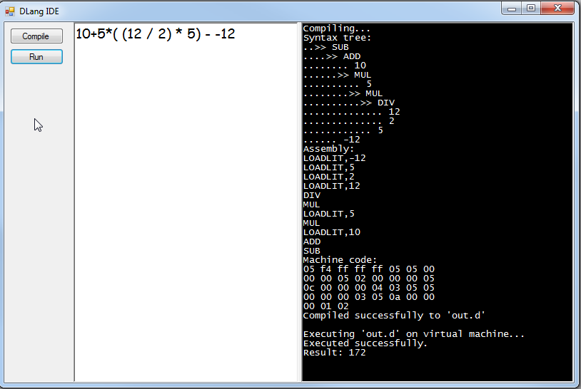

# Thunder: an educational programming-language toolchain

**Thunder** is a small, statically typed programming language with a complete toolchain built
for teaching **Programming Language Technology (PLT)**: a compiler, a virtual machine and an IDE
that shows what happens to a program inside each phase. Programs can be written in **English or
Pashto (پښتو)**, and the IDE is available in both languages, with a right-to-left layout for
Pashto.

```
source --lexer--> tokens --parser--> syntax tree --semantic analysis--> symbols & types
       --code generator--> bytecode (.thc) --virtual machine--> output
```

The IDE shows each of these artefacts in its own tab: the token stream, the abstract syntax tree,
the scopes and symbol table, the bytecode listing, a hex dump of the compiled file, and a
step-by-step debugger that shows the VM's stack and call frames, forwards and backwards.



*The original Windows-only "DumbLang" prototype (arithmetic expressions only) is kept, unchanged,
in [`dlang/`](dlang/).*

## Quick start

| | Linux | Windows (PowerShell) |
| --- | --- | --- |
| Start the IDE | `./run.sh` | `.\run.ps1` |
| Run all tests with coverage | `./run_tests.sh` | `.\run_tests.ps1` |

The first run builds the C++ toolchain into `build/release` (about a minute), then starts the IDE.
Pick a sample from the **Sample** list and press **Compile**, **Run** or **Debug**.

If PowerShell refuses to run scripts, use
`powershell -ExecutionPolicy Bypass -File .\run.ps1` (or `Set-ExecutionPolicy -Scope CurrentUser RemoteSigned`).

### Requirements

| | Linux | Windows |
| --- | --- | --- |
| C++ compiler | GCC 14+ (tested with GCC 15.2) | Visual Studio 2022/2026 with "Desktop development with C++" |
| Build system | CMake 3.25+ (Ninja optional) | CMake 3.25+ |
| Python | 3.10+ with Tkinter (`sudo apt install python3-tk`) | 3.10+ from python.org with "tcl/tk and IDLE" |
| Optional | `clang-tidy` (`./run_tests.sh --tidy`) | [OpenCppCoverage](https://github.com/OpenCppCoverage/OpenCppCoverage) for C++ coverage |

No third-party libraries are needed: the C++ code uses only the standard library (C++26 mode), and
the IDE and tools use only the Python standard library. Settings (language, font size, panel layout)
are saved in `~/.config/thunder/ide.json` (Windows: `%APPDATA%\Thunder\ide.json`).

## A taste of Thunder

```thunder
// Thunder uses Allman style (braces on lines of their own) and needs no semicolons.
struct Scientist
{
    name: string
    born: int
}

func fibonacci(n: int): int
{
    if (n < 2)
    {
        return n
    }
    return fibonacci(n - 1) + fibonacci(n - 2)
}

var people = [Scientist("Ada", 1815), Scientist(born: 1912, name: "Alan")]
for (var i = 0; i < len(people); i = i + 1)
{
    println(people[i], " -> ", fibonacci(i + 10))
}
dump(people[0])      // Scientist { name: string = "Ada" ... } one field per line
```

The same program in Pashto (`thunderc --translate ps` produces it):

```thunder
// ژبه: ps
جوړښت Scientist
{
    name: متن
    born: عدد
}
...
چاپ_کرښه(people[i]، « -> »، fibonacci(i + ۱۰))
```

The language has `int`, `bool`, `string`, arrays (`T[]`) and **structs**, variables and constants
with type inference, `if`/`else`, `while`, `for`, `break`/`continue`, functions with recursion, and a
few built-ins (`print`, `println`, `len`, `str`, `to_int`, `array`, `inspect`, `dump`, `copy`).
Statements end at the end of the line. Every error has a stable code and is reported by the phase
that detects it: lexical, syntax, semantic or runtime. There is no undefined behaviour: overflow,
division by zero and out-of-bounds indexing are reported as runtime errors.

See the **[language reference](docs/language.md)** and the
**[bytecode and VM reference](docs/bytecode.md)** (both also under the IDE's Help menu).

## Using the IDE

* **Language (English / پښتو):** switches the whole interface, the sample list and the default
  program language. Pashto uses a mirrored, right-to-left layout.
* **Sample list:** 16 English programs in teaching order (hello world → recursion → arrays →
  sorting → structs), 5 with deliberate errors and an infinite loop, and 10 Pashto programs.
* **Dockable panels:** the Editor, "Under the bonnet" (all the compiler tabs), Output and the
  Right-to-left view each have a title bar. Use it to **collapse** a panel (▾, or double-click the
  title), **float** it in its own window (⧉, close the window to dock it again), **move** it to the
  left, right or bottom area (☰) or **hide** it (✕; the View menu brings it back). Drag the borders
  between panels to resize them. View > Reset panel layout restores the default.
* **Live syntax highlighting** while typing, for English and Pashto programs.
* **Compile (F7):** fills every tab. Click a token, tree node, symbol, instruction or problem to
  highlight its source.
* **Run (F5) / Stop (Shift+F5):** runs the program and streams its output. A step limit and the
  Stop button keep infinite loops from freezing the IDE.
* **Debug (F9):** records the execution and opens the **VM** tab. Step by instruction or by
  source line, forwards and backwards, and watch the operand stack, frames, locals and globals.
* **Pipeline tab:** each phase's status, timing and output size, and what the phase does.
* **Format (Ctrl+Shift+F):** re-indents the code in Allman style. Typing `{` at the end of a line
  moves it onto its own line automatically.
* **Translate (Ctrl+T):** converts the program between English and Pashto keywords, built-ins,
  digits and punctuation.
* **Right-to-left view:** shows the program with correct right-to-left layout. It opens
  automatically for Pashto programs (see "Right-to-left text and Tk" below).
* **Build Log:** the exact `thunderc` / `thundervm` commands the IDE ran, so you can repeat them
  in a terminal.

## Command-line tools

```
thunderc program.th                    # compile to program.thc
thunderc --emit all program.th         # print tokens, AST, symbols, bytecode and hex dump
thundervm program.thc                  # run
thundervm --trace --stats program.thc  # watch every instruction execute
```

After `./run.sh` (or `./run_tests.sh`) the executables are in `build/release/bin` (or
`build/coverage/bin`). To build them by hand:

```
cmake -S . -B build/release -DCMAKE_BUILD_TYPE=Release
cmake --build build/release --config Release
```

## Tests and quality checks

`./run_tests.sh` / `.\run_tests.ps1` builds an instrumented copy of the toolchain in
`build/coverage` and runs:

* **C++ unit tests** for the lexer, parser, semantic analysis, code generator, bytecode format,
  VM and reports. They use a small built-in test framework (`tests/cpp/minitest.hpp`).
* **Golden tests:** every sample's complete output and diagnostics, in both languages, must match
  `tests/golden/<language>/*.expected`. After an intentional change, regenerate them with
  `THUNDER_UPDATE_GOLDEN=1 build/coverage/bin/thunder_tests samples` and review the diff.
* **Python tests:** the IDE logic (through a fake user interface, no display needed), the Tk
  interface (driving the real widgets), the bidi and shaping engine, the command-line tools and
  the toolchain interface.

It then prints a summary: test counts, line/function/branch coverage for C++ (gcov) and line
coverage for Python (a standard-library tracer, `tools/pycoverage.py`), compiler warnings,
complexity metrics and lines of code. The run **fails** if any test fails or if coverage is below
**90%**. On Linux every test also runs under AddressSanitizer and UndefinedBehaviorSanitizer.
`--tidy` adds clang-tidy static analysis, and `--clean` forces a full rebuild.

## Repository layout

| Path | Contents |
| --- | --- |
| `include/thunder/` | Public C++ headers of the compiler and VM library (`include/thunder/cli/` for the tools) |
| `src/core/` | The compiler and VM library (C++26): lexer, Pratt parser, semantic analysis, code generator, bytecode format, VM, language packs, translator, JSON reports |
| `src/cli/` | `thunderc` and `thundervm` command-line tools |
| `ide/thunder_ide/core/` | The IDE's application logic, independent of any GUI toolkit |
| `ide/thunder_ide/tk/` | The Tkinter user interface |
| `samples/en/`, `samples/ps/` | Sample programs in English and Pashto |
| `tests/cpp/`, `tests/python/`, `tests/golden/` | Test suites and expected outputs |
| `tools/` | Test driver, coverage and metrics tools, IDE launcher |
| `docs/` | Language and bytecode references |
| `dlang/`, `archive/` | Legacy projects, kept unchanged |
| `analysis.md` | The original analysis of the legacy code and the design decisions |

## IDE architecture: switching GUI toolkits

The IDE is split so that the GUI toolkit can be replaced (for example by Qt) without touching the
application logic:

* `core/controller.py` holds all the behaviour: files, samples, compiling, running, debugging,
  translating, language switching and settings.
* `core/ui.py` defines the interfaces a toolkit implements: `Backend` and `Scheduler`, and the
  `MainWindowView`, `EditorView`, `TreePanelView`, `TextPanelView`, `VmPanelView` and `SourceView`
  views.
* `core/viewmodels.py`, `core/layout.py`, `core/commands.py`, `core/bidi.py` and `core/editing.py`
  provide toolkit-neutral data: table rows, the dock layout, the menu and toolbar commands,
  right-to-left text layout and Allman auto-indentation.
* `tk/` is the Tkinter implementation, about 1,300 lines.

A Qt backend would implement the same interfaces (using `QDockWidget` for docking) and register in
`app.py` (`--ui qt`). The controller tests use a fake backend (`tests/python/fake_ui.py`), which is
also a complete, minimal example of everything a backend must provide.

### Right-to-left text and Tk

Tk 8.6 draws text strictly left to right and, on Linux, does not join Arabic-script letters. The
IDE therefore lays out right-to-left text itself (`core/bidi.py`: the Unicode Bidirectional
Algorithm and Arabic contextual shaping) for every read-only view: output, problems, tables,
labels, menus and the **Right-to-left view** of the program.

Tk cannot *edit* bidirectional text correctly. The editor therefore shows the program in logical
order (the order it is typed and stored) and right-aligns it, while the Right-to-left view beside it
shows the properly ordered rendering, updated as you type. On Linux, ten Pashto letters
(ټ ځ څ ډ ړ ږ ښ ګ ڼ ۍ) have no Unicode presentation forms, so Tk cannot join them to their
neighbours. They appear unjoined, but in the correct order. A Qt backend would remove these
limitations: Qt's text engine handles bidirectional editing and full Pashto shaping.

## Extending Thunder

The code is organised so that common extensions touch few places:

* **Another natural language:** copy `src/core/language_pashto.cpp`. It contains every keyword,
  built-in name, punctuation mark, digit, quote, output word and compiler/runtime message. Register
  the pack in `language_pack.cpp`, add the IDE's interface text to `ide/thunder_ide/core/i18n.py`,
  and add samples in `samples/<code>/`.
* **A new operator:** add a token in `include/thunder/token.hpp`, its binding power in
  `src/core/parser.cpp`, its type rule in `src/core/sema.cpp` and an opcode in the
  `THUNDER_OPCODES` table in `include/thunder/bytecode.hpp`.
* **A new built-in function:** add it to `src/core/builtins.cpp` (and a translated name to each
  language pack), then type-check it in `sema.cpp` and implement it in `vm.cpp`.

## Licence

MIT. See [LICENSE](LICENSE).
