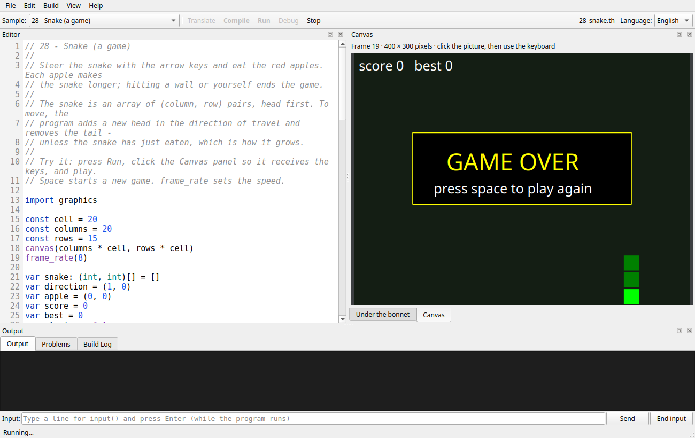
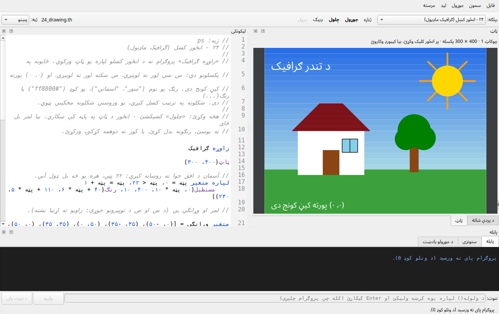

# The Thunder Graphics Reference

*Part of the [Thunder SDK reference](README.md).*

The built-in module **`graphics`** lets a program draw pictures, animate them and react to the
keyboard and the mouse. That is enough for simulations, visualisations and simple games. In the
IDE the picture appears in the **Canvas** panel; on the command line it can be saved as an SVG
image.

```thunder
import graphics

graphics.canvas(400, 300)
graphics.clear("navy")
graphics.circle(200, 150, 40, graphics.Color.orange)
graphics.text(10, 10, "Hello, graphics!", graphics.Color.white)
```

`import graphics` (at the top, without quotes) makes the module available. Every function is
then written with the module's name in front, `graphics.circle(...)`, and the colors are the
members of `graphics.Color`. A graphics function without the prefix is error `S067` ("'circle'
belongs to the module 'graphics': write graphics.circle"); one used without the import is `S049`.
How the built-in modules work in general (and the `math` and `random` modules that graphics
programs use a lot) is described in the [library reference](library.md).

Samples `28_drawing` to `35_snake` (in `samples/en/`, and in Pashto in `samples/ps/`) build up from
a still picture to a game. In the IDE, this document is under
**Help > Graphics reference**.

| Sample | Shows |
| --- | --- |
| `28_drawing` | the canvas, coordinates, colors, `graphics.rgb`, every kind of shape, text |
| `29_bouncing_ball` | an animation loop: clear, draw, `graphics.frame()`, move |
| `30_waves` | `math.sin`, `math.cos` and `math.tan` plotted and animated; radians and `math.pi()` |
| `31_orbits` | circular motion: planets on `math.cos`/`math.sin` orbits, and a spirograph from two circles |
| `32_pendulum` | `math.sqrt`, `math.exp` and `math.sin`: the pendulum formula against the equation of motion, step by step |
| `33_fireworks` | a particle simulation: structs, gravity, "fixed point" numbers, `random.int`, `filter`, mouse clicks |
| `34_life` | Conway's Game of Life: a 2D grid, keys (pause, restart) and mouse drawing |
| `35_snake` | a game: arrow keys, an array of pairs as the snake, collisions, score, game over and restart |

Outside the IDE a graphics program can have **a window of its own**: `thundervm --display sdl
program.thc` draws it through a display plug-in. The plug-ins are shared libraries with a
small C interface, so another one can be written for any graphics library — see the
[display reference](display.md) and `lib/display/`.

---

## 1. The canvas

* **Coordinates** are whole numbers of pixels. `(0, 0)` is the **top left** corner; x grows to the
  right and **y grows downwards** (as on every screen, unlike in mathematics).
* `graphics.canvas(width: int, height: int)` sets the size (1 to 2000 pixels each) and clears the
  canvas to white. Without it, the canvas is 400 × 300 pixels.
* **Shapes are drawn in order**, so later shapes cover earlier ones. Shapes may stick out of the
  canvas; the part outside is not shown.
* **The canvas keeps everything** drawn since the last `graphics.clear(...)`, like paint on paper.
  An animation therefore starts every frame with `graphics.clear(...)`. At most 100,000 shapes can be
  drawn between two clears (runtime error `R024`), which catches programs that forget to clear.

### Colors

A color is a member of the **`graphics.Color` enum** or a string:

* a **`graphics.Color` member** (the enum belongs to the module, so `import graphics` brings it
  in): `graphics.Color.red`, `.green`, `.blue`, `.white`, `.black`, `.yellow`, `.orange`, `.pink`,
  `.gray` (or `.grey`), `.brown`, `.purple`, `.sky`, `.gold` - `graphics.Colour` is accepted too.
  The compiler checks the name, so `graphics.Color.gren` is a compile error (`S062`) rather than a
  runtime one; `graphics.Color.values` lists them all, and in Pashto they are
  `ګرافیک.رنګونه.سور`, `ګرافیک.رنګونه.زرغون`, `ګرافیک.رنګونه.شین`, ... (see the
  [language reference](language.md), section 8, "Enums"). Without the prefix, `Color` is not
  declared (`S001`);
* a **name**: `black`, `white`, `gray`/`grey`, `silver`, `red`, `maroon`, `orange`, `gold`,
  `yellow`, `olive`, `lime`, `green`, `teal`, `aqua`/`cyan`, `sky`, `blue`, `navy`, `purple`,
  `fuchsia`/`magenta`, `pink`, `brown`. Names are not case-sensitive. Pashto programs may
  use `تور`, `سپین`, `سور`, `زرغون`, `شین`, `ژېړ`, `نارنجي`, `ګلابي`, `خړ`, `نسواري`, `بنفش`,
  `اسماني`, `طلايي`;
* a **code** `"#rrggbb"` or `"#rgb"` in hexadecimal: `"#ff8800"`, `"#f80"`;
* the result of **`graphics.rgb(red: int, green: int, blue: int): string`**, each from 0 to 255
  (values outside are clamped): `graphics.rgb(255, 136, 0)` is `"#ff8800"`. This makes colors you
  can calculate, e.g. a gradient: `graphics.rgb(40 + band * 6, 110, 230)`.

Anything else is runtime error `R021`.

---

## 2. Drawing

Every coordinate and size is a **decimal** (`float`), so a shape can sit wherever the arithmetic
puts it — `graphics.circle(cx + math.cos(a) * r, cy + math.sin(a) * r, 2.5, "white")` needs no
rounding. Whole numbers are widened automatically, so `graphics.circle(50, 50, 10, "red")` is
still correct, and a whole coordinate is written back as a whole number in SVG files and frame
records. Every `color` parameter takes a `graphics.Color` member as well as a string.

| Function | Draws |
| --- | --- |
| `graphics.clear(color: string)` | fills the whole canvas, removing everything drawn before |
| `graphics.pixel(x: float, y: float, color: string)` | one pixel |
| `graphics.line(x1: float, y1: float, x2: float, y2: float, color: string)` | a line from (x1, y1) to (x2, y2) |
| `graphics.rect(x: float, y: float, width: float, height: float, color: string)` | a filled rectangle; (x, y) is its top left corner |
| `graphics.rect_outline(x: float, y: float, width: float, height: float, color: string)` | the outline of a rectangle |
| `graphics.circle(x: float, y: float, radius: float, color: string)` | a filled circle; (x, y) is its centre |
| `graphics.circle_outline(x: float, y: float, radius: float, color: string)` | the outline of a circle |
| `graphics.text(x: float, y: float, message: string, color: string)` | text; (x, y) is its top left corner, for every script |

| Setting | Effect on what is drawn afterwards |
| --- | --- |
| `graphics.line_width(width: float)` | width of lines and outlines in pixels (0.1 to 100, default 1) |
| `graphics.text_size(size: float)` | height of text in pixels (1 to 400, default 16) |

A negative width or height draws the rectangle to the left of or above (x, y). A negative radius,
and settings outside their range, are runtime error `R022`, which says what the allowed range is.

There is no "triangle" or "polygon": `28_drawing` builds a roof from ever shorter lines, which is
also a good loop exercise.

---

## 3. Animation

An animation is a loop that draws one picture, a **frame**, at a time:

```thunder
import graphics

var x = 0
while true
    graphics.clear(graphics.Color.black)     # 1. start from an empty canvas
    graphics.circle(x, 150, 20, "orange")    # 2. draw everything where it is now
    graphics.frame()                         # 3. show the frame and wait for the next one
    x = (x + 4) % 400                        # 4. move things a little
```

| Function | Effect |
| --- | --- |
| `graphics.frame()` | shows the picture, then **waits** until the next frame is due, so the animation runs at the same speed on every computer |
| `graphics.frame_rate(fps: int)` | how many frames per second `graphics.frame()` shows: 1 to 120, default 30 |
| `graphics.show()` | shows the picture **now**, without waiting (for a picture that is built up step by step) |

* A picture that has not been shown when the program ends (a still drawing with no
  `graphics.frame()` or `graphics.show()`) is shown then, also after a runtime error, so you can
  see how far the drawing got.
* If a frame takes longer to compute than the frame rate allows, the animation simply runs
  slower; it does not try to catch up.
* An animation loop usually never ends: press **Stop** in the IDE. The IDE's safety limit on
  the number of instructions (which stops accidental endless loops) then applies **between two
  frames** rather than to the whole run, so an animation may run for as long as you like.
* For smooth slow movement, keep positions as decimals: `x = x + 0.35` moves a third of a pixel
  per frame. (`33_fireworks` predates decimals and keeps positions in tenths of a pixel instead,
  which is still a useful technique when a program must stay exact.)

---

## 4. Keyboard and mouse

| Function | Result |
| --- | --- |
| `graphics.key_pressed(): string` | the **next key press** not yet taken, or `""` if there is none |
| `graphics.key_down(key: string): bool` | `true` while `key` is **held down** |
| `graphics.mouse_x(): int`, `graphics.mouse_y(): int` | the mouse position, in whole canvas pixels |
| `graphics.mouse_down(): bool` | `true` while the mouse button is held down over the canvas |

**Key names** are lower case: `"left"`, `"right"`, `"up"`, `"down"`, `"space"`, `"enter"`,
`"escape"`, `"backspace"`, `"tab"`, and the letter or digit typed (`"a"`, `"7"`; with a Pashto
keyboard, Pashto letters such as `"ب"`). In Pashto programs the special keys have Pashto names:

| English | Pashto | | English | Pashto |
| --- | --- | --- | --- | --- |
| `left` | `کیڼ` | | `space` | `تشه` |
| `right` | `ښي` | | `enter` | `ننوتل` |
| `up` | `پورته` | | `escape` | `وتل` |
| `down` | `کښته` | | `backspace` | `شاته` |
| `tab` | `ټب` | | | |

`graphics.key_down` accepts either name.

* `graphics.key_pressed()` is a **queue**: every press is kept (up to 64) until the program takes
  it, so a quick double tap is never lost. A game typically takes one key per frame, as
  `35_snake` does: two quick turns then become two steps instead of a reversal into itself.
* `graphics.key_down` suits continuous movement, e.g. `if graphics.key_down("left")` then
  `x = x - 3` in every frame.
* For a single click, compare with the previous frame:
  `if graphics.mouse_down() and not was_down ...` then `was_down = graphics.mouse_down()`
  (`33_fireworks`).
* In the IDE, **click the Canvas panel** so that it receives the keyboard. The IDE gives it the
  keyboard automatically when the first frame appears.
* On the command line (without the IDE) there are no keys or mouse: `graphics.key_pressed()`
  returns `""` and `graphics.mouse_down()` returns `false`.

---

## 5. Random numbers

Simulations and games need random numbers. They are in the **`random` module**, which every
program has, with or without `import graphics` (see the [library reference](library.md),
"The random module"):

| Function | Result |
| --- | --- |
| `random.int(low: int, high: int): int` | a random whole number from `low` to `high`, **both included** (`low > high` is runtime error `R023`) |
| `random.float(): float` | a random decimal from 0 (included) to 1 (excluded) |
| `random.seed(seed: int)` | restarts the sequence: after the same seed, the same numbers follow |

Without a seed, every run is different. `thundervm --seed n` (and the golden tests) start from a
fixed seed. Thunder uses its own generator (SplitMix64), so a seed gives the same numbers on every
operating system and compiler.

---

## 6. In the IDE



* The **Canvas** panel is a tab next to "Under the bonnet". It comes to the front when the
  program shows its first frame. Like the other panels, it can be moved, floated in its own
  window (handy for games) or closed (View > Panels brings it back).
* The picture is scaled to fit the panel, keeping its proportions, so make the panel bigger
  for a bigger picture. Mouse positions are converted back to canvas pixels.
* The line above the picture shows the frame number and the canvas size.
* Text printed with `println` still goes to the Output panel. The Build Log reports how many
  frames were shown.
* The last picture stays visible after the program ends, until you compile or run again.



---

## 7. On the command line

```
thundervm picture.thc                        # runs; without a display, nothing is shown
thundervm --svg picture.svg picture.thc      # saves the final picture as an SVG image
thundervm --max-frames 100 --svg f.svg anim.thc   # stops an endless animation after 100 frames
thundervm --seed 7 game.thc                  # the same random numbers on every run
thundervm --canvas game.thc                  # the display protocol, as the IDE uses it (below)
```

Without `--canvas`, `graphics.frame()` does not wait (nobody is watching), so a headless run finishes as
fast as the computer allows. SVG files open in every web browser.

---

## 8. Under the bonnet

**In the VM.** The canvas is a list of shapes (`include/thunder/graphics.hpp`). Each drawing
function checks its arguments and appends a shape; `graphics.clear()` empties the list.
`graphics.frame()` and `graphics.show()` *present* the list to a **graphics host**, an interface with one method, `present`.
`thundervm --canvas` uses a host that writes to standard output; the tests use one that records
the frames. The built-ins are in `src/core/vm_graphics.cpp`; the shapes, colors, SVG output and the
protocol are in `src/core/graphics.cpp`.

**The display protocol** (`thundervm --canvas`) shares the program's normal input and output:

* Each frame is **one line on standard output**: the ASCII "record separator" character (code
  30), then a JSON object, then a line break:

  ```
  \x1e{"type":"frame","n":12,"width":400,"height":300,"keep":5,"shapes":[["circle",120,80,18,"#ffa500"]]}
  ```

  The IDE already has the first `keep` shapes of the previous frame, so a frame that only adds
  shapes sends just the new ones; after a `graphics.clear()`, `keep` is 0. Shapes are arrays:
  `["clear", color]`, `["pixel", x, y, color]`, `["line", x1, y1, x2, y2, color, width]`,
  `["rect", x, y, w, h, color]`, `["rect_outline", x, y, w, h, color, width]`,
  `["circle", x, y, r, color]`, `["circle_outline", x, y, r, color, width]`,
  `["text", x, y, message, color, size]`. Colors are always `"#rrggbb"`.
* **Events are lines on standard input**, starting with the same character:
  `key down left`, `key up left`, `mouse 120 45 1` (x, y, and 1 while the button is held). All
  other lines are what `input()` reads. `thundervm` reads them on a background thread, so a game
  never waits for the keyboard.
* The program's own text cannot start a frame by accident: while `--canvas` is on, a
  record separator in printed text is written as `�`.

**In the IDE.** `ide/thunder_ide/core/canvas.py` separates the records from the text output (a
record may arrive in several pieces) and keeps the current picture. That code runs on the thread
that reads the program's output, and the GUI paints at most one picture per repaint, so a fast
animation cannot flood the interface. `ide/thunder_ide/qt/panels.py` (`QtCanvas`) paints the
shapes with `QPainter` and turns keys and mouse movements into event lines.

**Why this design?** The VM runs in its own process, as it always has, so a stuck program can
never freeze the IDE, and the same `thundervm` works with and without a display. Sending shapes
rather than pixels keeps frames small: a typical frame of `35_snake` is under 300 bytes, compared
with 360 KB for a 400 × 300 bitmap.

---

## 9. Error codes

| Code | Meaning |
| --- | --- |
| `S049` | a graphics function used without `import graphics` |
| `S067` | a graphics function written without `graphics.` (`circle(...)` instead of `graphics.circle(...)`) |
| `S062` | a `graphics.Color` member that does not exist (`graphics.Color.gren`) |
| `R021` | not a color |
| `R022` | a size or setting outside its range (canvas size, radius, line width, text size, frame rate) |
| `R023` | `random.int(low, high)` with `low > high` |
| `R024` | more than 100,000 shapes since the last `graphics.clear()` |

---

## 10. Pashto names

The module is `ګرافیک` and `import graphics` is `راوړه ګرافیک` (the English `graphics` is accepted
too, also as the prefix: `graphics.دایره`). Like the rest of the Pashto vocabulary, these names are
drafts that await review by a native speaker.

| English | Pashto | | English | Pashto |
| --- | --- | --- | --- | --- |
| `graphics.canvas` | `ګرافیک.ټاټ` | | `graphics.clear` | `ګرافیک.ټاټ پاک کړه` |
| `graphics.pixel` | `ګرافیک.ټکی` | | `graphics.line` | `ګرافیک.لیکه` |
| `graphics.rect` | `ګرافیک.مستطیل` | | `graphics.rect_outline` | `ګرافیک.د مستطیل څنډه` |
| `graphics.circle` | `ګرافیک.دایره` | | `graphics.circle_outline` | `ګرافیک.د دایرې څنډه` |
| `graphics.text` | `ګرافیک.لیکنه` | | `graphics.text_size` | `ګرافیک.د لیکنې اندازه` |
| `graphics.line_width` | `ګرافیک.د لیکې پلنوالی` | | `graphics.rgb` | `ګرافیک.رنګ` |
| `graphics.frame` | `ګرافیک.چوکاټ` | | `graphics.show` | `ګرافیک.ښکاره کړه` |
| `graphics.frame_rate` | `ګرافیک.د چوکاټ چټکتیا` | | `graphics.key_pressed` | `ګرافیک.کښېکښل شوې تڼۍ` |
| `graphics.key_down` | `ګرافیک.تڼۍ کښېکښل شوې ده` | | `graphics.mouse_x` | `ګرافیک.موږک افقي` |
| `graphics.mouse_y` | `ګرافیک.موږک عمودي` | | `graphics.mouse_down` | `ګرافیک.موږک کښېکښل شوی` |
| `graphics.Color` (enum) | `ګرافیک.رنګونه` | | `random.int` | `تصادفي.عدد` |
| `random.seed` | `تصادفي.بنسټ` | | `random.float` | `تصادفي.اعشاري` |

The `graphics.Color` members are `سور` (red), `زرغون` (green), `شین` (blue), `سپین` (white),
`تور` (black), `ژېړ` (yellow), `نارنجي` (orange), `ګلابي` (pink), `خړ` (gray), `نسواري` (brown),
`بنفش` (purple), `اسماني` (sky) and `طلايي` (gold): `ګرافیک.رنګونه.سور`.

**From Thunder 0.6.** The graphics functions used to be written without a prefix (`circle(...)`,
`Color.red`, `random_int(1, 6)`); they are now `graphics.circle(...)`, `graphics.Color.red` and
`random.int(1, 6)`. The translator does not convert old programs. For a function such as
`circle`, the compiler's `S067` message says which prefix is missing; `Color` and `random_int` are
simply not declared (`S001`). The [library reference](library.md), "What changed in 0.7", has the
full list.

The Canvas panel is called `ټاټ` in the Pashto interface. The Pashto samples write coordinates as
`س` and `ص` (the Arabic-script letters used for x and y in mathematics).
